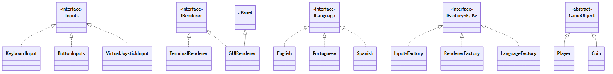

# Jogo das Moedas — versão 2: **desacoplada**

Projeto base da **Prática 03 — Coesão e Acoplamento**
Aula 08 — Design de Classes: Acoplamento e Coesão
Linguagem de Programação II — IMD/UFRN

Este é o **"depois"** — o terceiro e último passo da aula:

- `v0`: uma classe fazendo tudo → **baixa coesão**
- `v1`: quebrado em classes, mas tudo ligado no concreto → **alto acoplamento**
- **`v2` (este projeto)**: as mesmas ideias, com as dependências invertidas → **baixo acoplamento**

Na versão desacoplada, cada classe mantém uma responsabilidade clara: `Grid` representa o
cenário, `Level` executa uma fase e `MainGame` coordena a partida inteira.

> ### ⚠️ Este projeto está incompleto de propósito
>
> Três classes foram removidas. Elas serão entregues a você **uma de cada vez**, em
> `classes.zip`, ao longo dos itens 1, 2 e 3 da prática:
>
> | Classe | Item | O que ela faz |
> |---|---|---|
> | `ui/GUIRenderer.java` | 1 | Desenha o jogo numa janela gráfica (Swing) |
> | `inputs/ButtonInputs.java` | 2 | Entrada por botões clicáveis |
> | `inputs/VirtualJoystickInput.java` | 3 | Entrada por joystick simulado com o mouse |
>
> **Do jeito que está, o projeto compila e roda** — só com teclado e terminal.
> Compile e execute **antes de mexer em qualquer coisa**, para ver o ponto de partida.
>
> Copiar a classe para dentro de `src/` **não basta**: o projeto vai continuar sem
> compilar até você fazer mais duas coisas. Descobrir quais é parte do exercício.

---

## Como executar o jogo

```bash
cd jogo-das-moedas-v2
javac -d bin $(find src/main/java -name "*.java")
java -cp bin game.MainGame
```

No Windows, sem `find`, use:

```bash
dir /s /b src\main\java\*.java > sources.txt
javac -d bin @sources.txt
java -cp bin game.MainGame
```

Os cinco mapas ficam em `levels.txt`, na raiz do projeto, separados por uma
linha `---`. Use `#` para paredes, `.` para chao, `@` para o jogador e `$`
para moedas. O nível 1 é o padrão. A entrada padrão é teclado, o renderer
padrão é terminal e ambas as opções podem ser omitidas independentemente:

```bash
java -cp bin game.MainGame                       # funciona agora
java -cp bin game.MainGame -l 5                  # funciona agora
java -cp bin game.MainGame -r gui                # só depois do item 1
java -cp bin game.MainGame -i buttons            # só depois do item 2
java -cp bin game.MainGame -i joystick -r gui    # só depois do item 3
```

### Trocando entrada e saída

Esta é a demonstração principal. O **mesmo jogo** recebe opções independentes:
`-i` escolhe a entrada (`keyboard`, `buttons` ou `joystick`) e `-r` escolhe o
renderer (`terminal` ou `gui`). A opção `-l` escolhe o nível inicial.

```bash
java -cp bin game.MainGame -i keyboard -r terminal
java -cp bin game.MainGame -i keyboard -r gui
java -cp bin game.MainGame -i buttons -r terminal
java -cp bin game.MainGame -i joystick -r gui
```

Pelo Eclipse: `Run As` → `Run Configurations...` → aba `Arguments` →
escreva, por exemplo, `-i keyboard -r gui` em *Program arguments*.

O jogo pode combinar qualquer entrada com qualquer renderer. Quem junta as
peças é só o `MainGame`; a classe `Level` não muda conforme a combinação.
`InputsFactory` recebe `InputsEnum` e `RendererFactory` recebe `RendererEnum`.

As duas implementam a mesma interface genérica, que tem **dois** parâmetros de tipo —
`E` é o que se cria, `K` é a chave que decide qual criar:

```java
public interface IFactory<E, K> {
    E create(K key);
}
```

Ou seja, `InputsFactory implements IFactory<IInputs, InputsEnum>` e
`RendererFactory implements IFactory<IRenderer, RendererEnum>`.

---

## Estrutura

```
src/main/java/game/
├── MainGame.java                  ← coordena fases e escolhe implementacoes
├── Level.java                     ← regras e fluxo de uma fase
├── enums/
│   ├── CommandsEnum.java          ← comandos reconhecidos pela fase
│   ├── InputsEnum.java             ← modos de entrada
│   └── RendererEnum.java           ← modos de saída
├── inputs/
│   ├── IInputs.java               ← contrato das entradas
│   ├── InputsFactory.java          ← cria entrada conforme InputsEnum
│   ├── KeyboardInput.java         ← entrada pelo teclado
│   ├── ButtonInputs.java            ✗ AUSENTE — você adiciona no item 2
│   └── VirtualJoystickInput.java    ✗ AUSENTE — você adiciona no item 3
├── utils/
│   ├── LevelLoader.java            ← le o TXT e converte os dados da fase
│   └── IFactory.java               ← contrato generico para factories
├── ui/
│   ├── IRenderer.java             ← contrato da saída
│   ├── RendererFactory.java        ← cria saida conforme RendererEnum
│   ├── TerminalRenderer.java      ← desenha no console
│   └── GUIRenderer.java             ✗ AUSENTE — você adiciona no item 1
└── world/
   ├── Grid.java                  ← dados do cenario, dimensoes e paredes
   ├── Progress.java             ← pontuação acumulada entre missões
   └── gobjects/
      ├── GameObject.java       ← objeto do jogo
      ├── Player.java           ← posição e movimento do jogador
      └── Coin.java             ← moedas coletáveis
```

No item 5 você vai criar um pacote novo, `game/language/`, e um enum novo em
`game/enums/`. Onde exatamente cada arquivo entra é decisão sua — e você justifica
no final deste arquivo.

---

## As três ideias do projeto

### 1. Injeção de dependência

`Level` não usa `new` para nada que venha de fora. Tudo chega pelo construtor:

```java
public Level(Grid grid, Player player, Progress progress,
             List<Coin> coins, IInputs input, IRenderer renderer)
```

`MainGame` carrega cada `Grid`, monta o `Level` correspondente e preserva o
objeto `Progress` entre as fases. A fase depende das interfaces `IInputs` e
`IRenderer`, sem conhecer as implementacoes concretas. `InputsFactory` e
`RendererFactory` escolhem essas implementacoes com base em opções
independentes e implementam `IFactory<IInputs, InputsEnum>` e
`IFactory<IRenderer, RendererEnum>`, respectivamente.

`Player` representa o avatar na fase; `Progress` guarda a pontuação
cumulativa e é compartilhado pelas instâncias de `Level` criadas por `MainGame`.

### 2. Interface para contrato, classe abstrata para reúso

Duas decisões diferentes no mesmo projeto, e vale entender por quê:

| | Escolha | Motivo |
|---|---|---|
| `IInputs` | **interface** | Teclado, joystick e toque não têm **nenhum código em comum** — cada um lê de um lugar diferente. Não há nada a herdar, só um contrato a cumprir. |
| `GameObject` | **classe abstrata** | Jogador e moeda compartilham **estado real** (as coordenadas `x` e `y`) e o código que cuida dele. Só o símbolo desenhado muda — e é o único método abstrato. |

Guarde esta tabela: no item 5 você vai ter que tomar essa mesma decisão sozinho,
para os idiomas.

### 3. Polimorfismo

O método `Level.runTurn()` chama `input.waitCommand()` sem nunca perguntar
que tipo de entrada é aquela. Quem decide como responder é o objeto concreto, em tempo de execução.

---

## A comparação que resume a aula

```bash
grep -n "new \|System.out" src/main/java/game/Level.java
```

Esse comando não devolve nada. `Level` aplica **todas** as regras do jogo — colisão, coleta,
pontuação, fim de fase — sem criar um único objeto e sem imprimir uma única linha.

Rode o mesmo comando no `Game.java` da v1, mostrada em aula, e compare. Depois conte,
nos dois projetos, quantos arquivos você precisaria abrir para adicionar uma entrada nova.

Guarde esse comando: no item 5 ele vira **critério de correção**. Quando você terminar
a estratégia de idiomas, nenhum texto de mensagem pode aparecer em `Level.java`.

---
---

# ✍️ Parte a preencher pela dupla

> Tudo abaixo desta linha é sua entrega. Responda com frases curtas e diretas —
> respostas certas e longas não valem mais que respostas certas e curtas.

## Identificação

| | Nome completo | Matrícula |
|---|---|---|
| Integrante 1 | Luis Guilherme Lucas Barreto | 20250030776 |
| Integrante 2 | *(deixe em branco se fez individualmente)* | |

## Ambiente

- **Versão do JDK** (saída de `java -version`): OpenJDK 25.0.4.1 (Temurin-25.0.4.1+1 LTS, build 2026-08-18)
- **Sistema operacional**: Windows
- **Comando de compilação que você usou**: `$files = Get-ChildItem src\main\java -Recurse -Filter *.java | ForEach-Object FullName; javac -d bin $files` (PowerShell; no Linux/macOS: `javac -d bin $(find src/main/java -name "*.java")`)
- **Comando de execução que você usou**: `java -cp bin game.MainGame` (ex.: `java -cp bin game.MainGame -i buttons -r gui -lang spanish`)

## Itens 1 a 3 — as três classes devolvidas

**1. Preencha conforme foi fazendo:**

| Item | Classe adicionada | Quais OUTROS arquivos você precisou abrir e editar? |
|---|---|---|
| 1 | `GUIRenderer` | `RendererEnum.java`, `RendererFactory.java` |
| 2 | `ButtonInputs` | `InputsEnum.java`, `InputsFactory.java` |
| 3 | `VirtualJoystickInput` | `InputsEnum.java`, `InputsFactory.java` |

**2.** Antes de adicionar cada classe, você rodou o jogo pedindo o modo que ainda não
existia. Qual foi a mensagem de erro, e de qual arquivo ela veio?

> Todas vieram como `IllegalArgumentException`, lançada por `InputsEnum.java` ou `RendererEnum.java`, pois o valor pedido ainda não existia no enum:
> - `-r gui`: `Renderer must be gui or terminal: gui` (`RendererEnum.java`)
> - `-i buttons`: `Mode must be buttons, joystick, or keyboard: buttons` (`InputsEnum.java`)
> - `-i joystick`: `Mode must be buttons, joystick, or keyboard: joystick` (`InputsEnum.java`)

**3.** Depois de copiar a classe para dentro de `src/`, o projeto ainda não compilava.
Qual foi o erro do compilador, e por que ele aconteceu?

> O compilador informou que a expressão `switch` não cobria todos os valores possíveis. Isso ocorreu porque foram adicionados novos valores aos enums antes dos respectivos casos nas factories: `InputsFactory` precisava tratar `BUTTONS` e `JOYSTICK`, e `RendererFactory` precisava tratar `GUI`.

**4.** `Level.java` aparece em alguma linha da tabela do item 1? Por que isso é o
resultado esperado de um projeto com baixo acoplamento?

> Não. `Level` depende apenas das interfaces `IInputs` e `IRenderer`, sem conhecer as classes concretas. Por isso, novas implementações só exigem mudanças nos enums e nas factories, que escolhem e criam as peças.

## Item 4 — pares cruzados

**5.** Rode as duas combinações e relate o que aconteceu:

| Combinação | Funcionou? | Precisou alterar alguma classe? |
|---|---|---|
| `-i buttons -r terminal` | Sim. O jogo desenha no console e os botões da janela controlam o jogador. | Não |
| `-i keyboard -r gui` | Sim. O jogo desenha na janela gráfica e o teclado controla o jogador, digitando `w`, `a`, `s`, `d` ou `q` + Enter **no terminal**, pois `KeyboardInput` lê do console e não da janela. | Não |
| `-i joystick -r terminal` | Sim. O jogo desenha no console e o mouse no joystick virtual controla o jogador. | Não |

**6.** O que essas duas execuções provam sobre a relação entre entrada e saída no projeto?

> Provam que entrada e saída são independentes: qualquer entrada funciona com qualquer renderer, sem alterar nenhuma classe. `Level` conhece apenas as interfaces `IInputs` e `IRenderer`, e `MainGame` escolhe, por meio das factories, qual implementação concreta usar para cada lado. O acoplamento entre entrada e saída é, portanto, baixo.

## Item 5 — a estratégia de idiomas

**7.** Liste os arquivos que você **criou**:

> Todos em `src/main/java/game/`:
> - `enums/LanguageEnum.java`
> - `language/ILanguage.java`
> - `language/English.java`
> - `language/Portuguese.java`
> - `language/Spanish.java`
> - `language/LanguageFactory.java`

**8.** Liste os arquivos que você **modificou** e diga, em uma linha cada, o que mudou:

> - `MainGame.java`: nova opção `-lang` (padrão inglês), cria o idioma pela `LanguageFactory`, passa-o às factories e ao `Level`, e usa-o nas mensagens finais.
> - `Level.java`: recebe `ILanguage` pelo construtor e troca todos os textos por chamadas ao idioma.
> - `ui/TerminalRenderer.java`: recebe `ILanguage` e obtém dele o texto do score e o prompt de comando.
> - `ui/GUIRenderer.java`: recebe `ILanguage` e obtém dele o título da janela e o texto do score.
> - `ui/RendererFactory.java`: recebe `ILanguage` no construtor e o repassa aos renderers.
> - `inputs/ButtonInputs.java`: recebe `ILanguage` e obtém dele o título da janela e os rótulos dos botões.
> - `inputs/VirtualJoystickInput.java`: recebe `ILanguage` e obtém dele o título da janela.
> - `inputs/InputsFactory.java`: recebe `ILanguage` no construtor e o repassa às entradas que o usam.
>
> `IInputs`, `IRenderer` e `IFactory` **não** foram alterados. Também não alterei `Grid`, `Progress`, `GameObject`, `Player`, `Coin`, `CommandsEnum` nem `LevelLoader`.

**9.** `ILanguage` ficou como **interface** ou como **classe abstrata**? Justifique usando
o mesmo critério da tabela da seção "Interface para contrato, classe abstrata para reúso".

> **Interface.** Inglês, português e espanhol não têm **nenhum código em comum**: cada classe só conhece suas próprias frases. Não há estado nem lógica a herdar, só um contrato a cumprir. Uma classe abstrata com o campo `IRenderer renderer` criaria um estado compartilhado artificial e prenderia o idioma a um renderer específico, enquanto aqui o renderer chega como parâmetro de cada método.

**10.** Por que os métodos de `ILanguage` recebem **dados** (como o valor do score) em vez
de receberem o texto pronto? O que aconteceria com o design se `Level` montasse a frase e
passasse a `String` para a classe de idioma?

> Porque a ordem das palavras e a pontuação variam entre idiomas, e só a classe do idioma sabe montar a frase corretamente. Se `Level` montasse o texto, ele voltaria a conter frases em um idioma fixo, e a classe de idioma seria só um repasse de `String`. Isso espalharia texto pelas classes de regra, quebraria a coesão de `Level` e exigiria alterá-lo para cada idioma novo.

**11.** Rode `grep -n "new \|System.out" src/main/java/game/Level.java` e também procure
por texto literal entre aspas em `Level.java`. Sobrou alguma mensagem? Se sim, qual e por quê?

> O `grep` não devolve nada. Na busca por texto entre aspas, a única ocorrência é o comentário de documentação (`"new"`, linha 21), que não é mensagem exibida. Nenhuma mensagem sobrou em `Level.java`.

**12.** Quantos arquivos você precisaria modificar para adicionar um **quarto idioma**
(por exemplo, francês)? Liste-os.

> Dois arquivos modificados, além de um novo: criar `language/French.java`, adicionar `FRENCH` em `enums/LanguageEnum.java` e adicionar o `case` em `language/LanguageFactory.java`. Nenhuma classe de regra ou de interface muda.

**13.** `KeyboardInput.getDeviceName()` devolve `"Keyboard"`, que aparece na tela.
Esse texto **deve** ser traduzido? Não existe resposta única aqui — defenda a sua.

> Não o traduzi. É o nome do dispositivo, um identificador técnico que `IInputs` devolve apenas como dado para a mensagem de início. A frase em volta dele é traduzida pelo idioma, e o nome do dispositivo é inserido nela. Traduzi-lo exigiria que as classes de entrada conhecessem o idioma, aumentando o acoplamento por pouco ganho. Já os títulos de janela e rótulos de botões, que são texto de interface, foram traduzidos.

## Item 6 — diagrama UML

**14.** Com que ferramenta você fez o diagrama?

> O diagrama foi gerado com auxílio da ferramente de IA claude, exportado como imagem PNG com o Mermaid CLI. O código-fonte está em [diagrama-uml.mmd](./diagrama-uml.mmd).



**15.** Confirme: o diagrama mostra **apenas** herança (generalização) e implementação de
interface (realização), sem associações entre classes?  `[x] sim`

## Fechamento

**16.** Compare com a v1 mostrada em aula: quantos arquivos mudam lá, e quantos mudam
aqui, para adicionar uma entrada nova? O que explica a diferença?

> Na v1, a escolha do dispositivo ficava espalhada dentro da própria classe de regras (`Game`), ligada a classes concretas. Adicionar uma entrada exigia criar a nova classe e **editar a classe de regras** (`Game`), pelo menos 2 arquivos, com risco de quebrar as regras. Aqui são 3 arquivos, mas só 1 é lógica nova: criar a classe da entrada, adicionar o valor em `InputsEnum` e o `case` em `InputsFactory`. `Level`, `MainGame`, `Player`, `Grid` e as demais classes de regra não mudam. A diferença se explica porque `Level` depende só de `IInputs` e recebe a implementação por injeção de dependência, e a escolha do concreto fica concentrada em enum e factory.

**17.** Alguma parte do projeto que você achou **mais acoplada do que precisava**?
Crítica honesta conta ponto — aponte o lugar e diga o que faria.

> MainGame faz muita coisa. Lê argumentos, monta as peças e controla o laço das fases. Eu extrairia a leitura de argumentos para uma classe própria, o que deixaria MainGame só como montagem.
